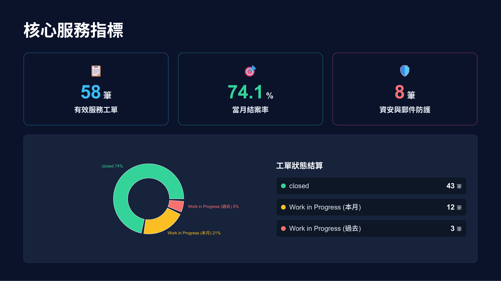
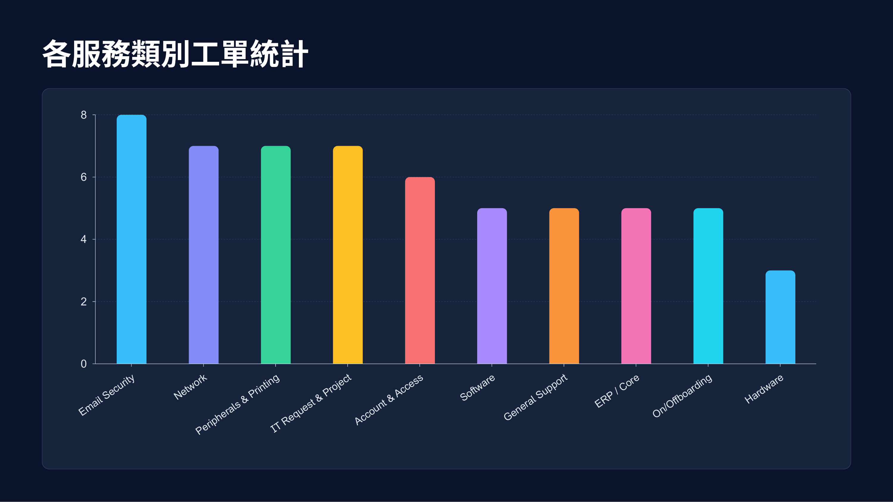
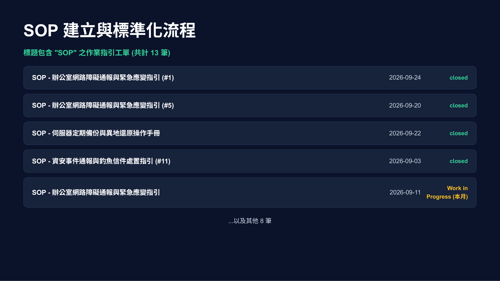

# 📊 Zammad Monthly Report & Slide Generator

<div align="center">

🌐 **[English](README.md)** | **[繁體中文 (Traditional Chinese)](README.zh-TW.md)**

<br />

[](https://python.org)
[](https://reactjs.org/)
[](https://open-slide.dev/)
[](https://github.com/Json105/Zammad-Monthly-Report/actions/workflows/ci.yml)
[](LICENSE)

**Automatically fetch monthly ticket data from Zammad, generating multi-sheet Excel reports and modern interactive presentation slides.**

<br />



<br />
<br />

[🎯 Background & Benefits](#-background--benefits) •
[📸 Visual Showcase](#-visual-showcase) •
[✨ Quick Demo](#-1-minute-quick-demo-mock-mode) •
[🚀 Getting Started](#-getting-started-connect-to-zammad) •
[📖 CLI Reference](#-cli-commands--options)

</div>

---

## 🎯 Background & Benefits

### 📌 Problem Statement & Motivation
In enterprise IT operations and customer support workflows, monthly reporting frequently encounters the following bottlenecks:
- **Time-Consuming Manual Work**: Teams spend hours manually exporting data from Zammad, cleaning fields, and creating separate Excel sheets for ticket statuses.
- **High Presentation Overhead**: Preparing slides for executive or cross-team meetings requires manually making static charts and pasting them into PowerPoint.
- **Inaccurate Categorization**: Tickets often accumulate under generic `Others` groups without proper routing, distorting metrics and workload analysis.

### 🚀 Business Value & Key Benefits
- ⏱️ **90%+ Time Savings**: Cuts down report and slide preparation time from several hours to **under 10 seconds** with a single command.
- 📊 **Accurate & Insightful Data**: Automatically aggregates status breakdowns, department allocations, SOP tracking, and future goals to empower data-driven decisions.
- 🎞️ **Modern Interactive Slides**: Powered by [Open-Slide](https://open-slide.dev/), replacing rigid static slides with responsive, interactive web presentations.
- 🤖 **Smart Ticket Reclassification**: Features rule-based automated suggestions to reclassify generic `Others` tickets into correct service groups.
- 🎲 **Zero Setup Barrier**: Built-in Mock Mode allows instant evaluation of reports and slides without requiring live Zammad API credentials.

---

## 📸 Visual Showcase

Transform operational ticket metrics into dynamic, executive-ready presentations (Powered by React 18 + Open-Slide + Recharts):

### 1. Executive KPIs & Status Distribution
Instantly track total ticket volume, monthly resolution rates, security incidents, and interactive donut status breakdown:
<div align="center">
  
</div>

<br />

### 2. Service Category Breakdown
Automatically aggregate hardware/software, email security, account permissions, and IT infrastructure loads into clear comparative bar charts:
<div align="center">
  
</div>

<br />

### 3. SOP & Standardization Workflows
Drill down into tickets tagged with `SOP` or priority milestones to foster institutional knowledge and standardized IT operations:
<div align="center">
  
</div>

---

## ✨ Key Features

- 🔄 **Automated Monthly Export**: Batch retrieves tickets, states, groups, and assignees via Zammad REST API.
- 📑 **Smart Multi-Sheet Excel**: Generates an "All Tickets" master sheet and automatically splits tickets into separate sheets by status (e.g., `closed`, `open`, `pending`).
- 🎞️ **Modern Interactive Slides**: Built on the [Open-Slide](https://open-slide.dev/) ([GitHub](https://github.com/1weiho/open-slide)) presentation engine, featuring:
  - 🍩 Ticket Status Distribution Pie Chart
  - 📊 Department / Group Ticket Distribution Bar Chart
  - 🏷️ Featured & Tagged Tickets
  - 📝 SOP Workflow & Knowledge Base Ticket Tracking
  - 🎯 Next Month Goals & Action Items
- 🎲 **Built-in Mock Mode**: Generate realistic mock data in 1 second without needing a live Zammad API token to test the full workflow!

---

## ⚡ 1-Minute Quick Demo (Mock Mode)

Want to see what the generated reports and presentation look like first? The project **comes with a built-in interactive demo report (`demo-report`)** ready out-of-the-box without requiring any Zammad credentials or Python setup:

```bash
# 1. Clone the repository and navigate to the slide app
git clone https://github.com/Json105/Zammad-Monthly-Report.git
cd Zammad-Monthly-Report/zammad-report-slide

# 2. Install dependencies & start the presentation dev server
npm install
npm run dev
```

Open `http://localhost:5174/` in your browser and select **`IT Service Monthly Report (Demo)`** from the left menu!

👉 **To customize mock ticket counts or generate an Excel report as well**:
```bash
# Return to the project root
cd ..
python -m venv venv && source venv/bin/activate
pip install -r requirements.txt
python generate_report.py --mock --mock-count 80
```

---

## 🚀 Getting Started (Connect to Zammad)

### Step 1: Configure Environment Variables

Copy the environment variables template and fill in your Zammad credentials:

```bash
cp .env.example .env
```

Edit `.env`:

```env
ZAMMAD_URL=https://support.your-company.com
ZAMMAD_API_TOKEN=your_actual_zammad_api_token_here
```

> 💡 **How to obtain a Token**: Log into Zammad ➜ Click your avatar ➜ **Profile** ➜ **Token Access** ➜ Create a Personal Access Token with `ticket.agent` or relevant read permissions.

### Step 2: Generate the Monthly Report

```bash
# By default, fetches all tickets from the previous month
python generate_report.py

# Or specify a target month (Format: YYYY-MM)
python generate_report.py --month 2026-07
```

After execution, the following files will be generated:
1. `Zammad_Report_YYYY-MM.xlsx`: Comprehensive Excel workbook categorized by ticket status.
2. `zammad-report-slide/public/data/tickets.json`: Structured JSON data feed consumed by the slide presentation.

### Step 3: Launch Interactive Slides

```bash
cd zammad-report-slide
npm run dev
```

---

## 📖 CLI Commands & Options

| Option | Description | Example |
| :--- | :--- | :--- |
| *(No arguments)* | Automatically fetches and exports real tickets from the **previous month** | `python generate_report.py` |
| `--month YYYY-MM` | Specify a custom month to fetch | `python generate_report.py --month 2026-06` |
| `--mock` | Run in mock data mode (No Zammad connection required) | `python generate_report.py --mock` |
| `--mock-count N` | Set number of simulated tickets in mock mode (Default: 60) | `python generate_report.py --mock --mock-count 100` |
| `-h`, `--help` | Display help message and options | `python generate_report.py -h` |

---

## 🛠️ Helper Utilities

- **Query Zammad Ticket States**:
  ```bash
  python get_states.py
  ```
- **Export Zammad Users, Groups, and States Lookup Dictionaries**:
  ```bash
  python export_zammad_data.py
  ```
- **Auto-Reclassify "Others" Group Tickets**:
  ```bash
  # Preview reclassification recommendations for previous month (Dry-Run)
  python reclassify_others.py --dry-run

  # Apply reclassifications to a specific month
  python reclassify_others.py --month 2026-07
  ```

---

## 🧪 Running Unit Tests

Run the test suite with `pytest`:

```bash
pytest
# or
python -m pytest tests/ -v
```

---

## 📁 Project Directory Structure

```text
zammad-monthly-report/
├── .env.example            # Environment configuration template (Copy to .env)
├── .gitignore              # Git ignore rules
├── pyproject.toml          # Python project metadata & tool configuration
├── requirements.txt        # Python dependency list
├── README.md               # English project documentation
├── README.zh-TW.md         # Traditional Chinese project documentation
├── generate_report.py      # 🌟 Main script: Generates Excel report & slide data
├── reclassify_others.py    # Utility: Smart ticket reclassification
├── export_zammad_data.py   # Utility: Export reference dictionaries
├── get_states.py           # Utility: Query ticket state IDs
├── zammad_utils/           # 📦 Shared Python modules
│   ├── config.py           #    Unified env loading, validation & HTTPS check
│   ├── api.py              #    Shared Zammad API helpers
│   └── date_utils.py       #    Month-range calculation (leap-year aware)
├── tests/                  # 🧪 Unit tests (pytest)
│   ├── test_api.py
│   ├── test_config.py
│   ├── test_date_utils.py
│   ├── test_reclassify.py
│   └── test_report_filter.py
└── zammad-report-slide/    # 🌟 Open-Slide presentation project
    ├── .env.example        # Slide presentation branding template
    ├── package.json
    ├── open-slide.config.ts
    ├── public/data/
    │   └── tickets.json    # Ticket data generated by the Python script
    ├── themes/
    │   └── monthlyReportTemplate.tsx # Slide layout and Recharts visualizations
    └── slides/
        ├── demo-report/    # 🌟 Built-in Demo report presentation (Ready out-of-the-box)
        └── report-YYYY-MM/ # Auto-generated monthly slide decks (Generated by generate_report.py)
```

---

## 📄 License

MIT © [Jason Liao](https://github.com/Json105)
