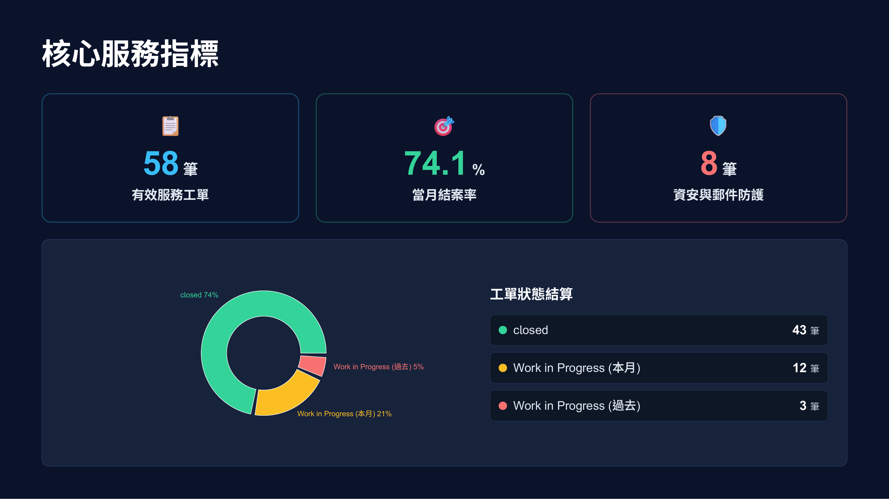
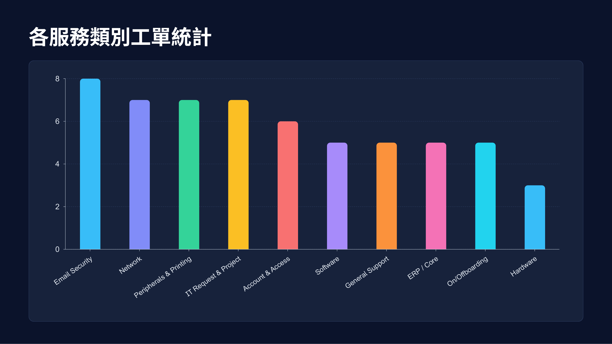
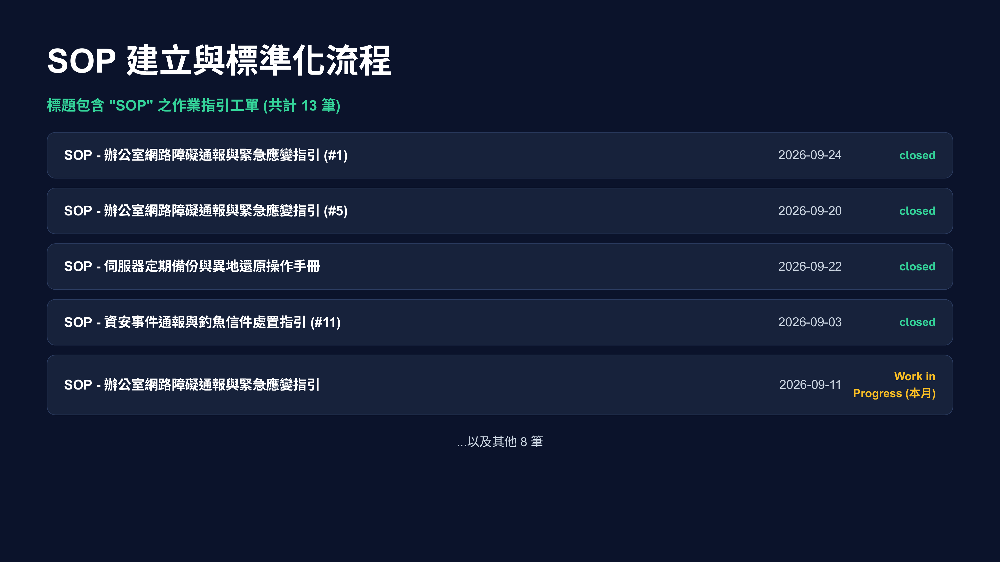

# 📊 Zammad Monthly Report & Slide Generator

<div align="center">

🌐 **[English](README.md)** | **[繁體中文 (Traditional Chinese)](README.zh-TW.md)**

<br />

[](https://python.org)
[](https://reactjs.org/)
[](https://open-slide.dev/)
[](https://github.com/Json105/Zammad-Monthly-Report/actions/workflows/ci.yml)
[](LICENSE)

**Automatically fetch Zammad ticket data across monthly, 15th-cutoff billing cycles, or custom date ranges — generating structured multi-sheet Excel audit workbooks and modern interactive presentation slides.**

<br />


<br />
<br />

[🎯 Background & Benefits](#-background--benefits) •
[📸 Visual Showcase](#-visual-showcase) •
[✨ Quick Demo](#-1-minute-quick-demo-mock-mode) •
[🚀 Getting Started](#-getting-started-connect-to-zammad) •
[📖 CLI Reference](#-cli-commands--options)

</div>

---

## 🎯 Background & Benefits

### 📌 Problem Statement & Motivation
In enterprise IT operations and customer support workflows, recurring reporting frequently encounters the following bottlenecks:
- **Time-Consuming Manual Work**: Teams spend hours manually exporting data from Zammad, cleaning fields, filtering out `merged` duplicates, and creating separate Excel sheets for ticket statuses.
- **High Presentation Overhead**: Preparing executive or cross-team slides requires manually updating static charts, re-verifying totals, and pasting screenshots into PowerPoint.
- **Inconsistent Numbers & Categorization**: Tickets accumulate under generic `Others` groups without proper routing, and hand-calculated spreadsheet totals easily drift out of sync with presentation slides.

### 🚀 Business Value & Key Benefits
- ⏱️ **90%+ Time Savings**: Reduces hours of manual ticket cleanup, spreadsheet formatting, and slide creation to **under 10 seconds** with a single command.
- 📊 **100% Metric Reconciliation (Single Source of Truth)**: A shared classification engine (`zammad_utils/report_metrics.py`) excludes `merged` duplicates and guarantees that openpyxl structured Excel Tables (`ValidServiceTickets`, `AuditSummary`) match the React/Recharts slide KPIs down to every ticket, complete with an in-slide detail viewer and one-click `.xlsx` download.
- 📅 **Flexible Reporting Cycles**: Supports default **15th-to-15th SLA/billing cutoff cycles**, arbitrary `--start`/`--end` ranges, and full calendar months (`--full-month`), accurately distinguishing in-period new tickets from cross-period closures and historical backlog.
- 🔒 **White-Label & Zero-Leak Architecture**: Company branding, contact info, HQ escalation tags, and custom SVG logos are injected via gitignored `.env` files with clean isometric defaults — ready for enterprise deployment and safe for public portfolio showcase.
- 🛡️ **Automated Quality Gate & CI**: Integrated `./scripts/check-done.sh` (Python syntax checks, module imports, **84 `pytest` unit tests**, and optional frontend production build) backed by `.agents/hooks.json` (`Stop` hook) and GitHub Actions CI.
- 🤖 **Smart Ticket Reclassification**: Rule-based recommendations automatically reclassify generic `Others` tickets into the right service groups.
- 🎲 **Zero Setup Barrier**: Built-in `demo-report` deck and `--mock` mode enable instant evaluation without live Zammad API credentials.

---

## 📸 Visual Showcase

Transform operational ticket metrics into dynamic, executive-ready presentations (Powered by React 18 + Open-Slide + Recharts):

### 1. Executive KPIs & Status Distribution
Instantly track total ticket volume, monthly resolution rates, security incidents, and interactive donut status breakdown:
<div align="center">
  
</div>

<br />

### 2. Service Category Breakdown
Automatically aggregate hardware/software, email security, account permissions, and IT infrastructure loads into clear comparative bar charts:
<div align="center">
  
</div>

<br />

### 3. SOP & Standardization Workflows
Drill down into tickets tagged with `SOP` or priority milestones to foster institutional knowledge and standardized IT operations:
<div align="center">
  
</div>

---

## ✨ Key Features

- 🔄 **Automated Zammad Extraction**: Batch retrieves tickets, states, groups, assignees, and tags via Zammad REST API, filtering by authorized customer domains (`ALLOWED_DOMAINS`) and removing stale pre-period closed tickets.
- 📅 **Multi-Cycle & Custom Range Support**: Runs on a 15th-to-15th cutoff cycle by default, with CLI flags for custom `--start`/`--end` date intervals or `--full-month` calendar reporting.
- 📑 **Structured Excel Audit Tables**: Outputs openpyxl formatted Excel Tables (`ValidServiceTickets`, `AuditSummary`, `AllTickets`, plus per-status sheets) with auto-fitted CJK column widths and freeze panes for instant reconciliation.
- 🎞️ **White-Label Interactive Slides**: Built on [Open-Slide](https://open-slide.dev/) ([GitHub](https://github.com/1weiho/open-slide)) + Recharts with a corporate isometric design system, featuring:
  - 🍩 Ticket Status Distribution Donut Chart & Service Domain Breakdown
  - 📊 Service Category Bar Chart & Auto-Paginated In-Progress Backlog
  - 🏷️ HQ / Cross-Border Escalation & Tagged Ticket Tracking (`VITE_HQ_EMAIL`)
  - 📝 SOP Workflow & Knowledge Base Ticket Tracking
  - 📥 Built-in Effective Ticket Modal Viewer & One-Click `.xlsx` Download
  - 🎯 Data-Driven Next-Cycle Milestones & White-Label Env Branding (`VITE_LOGO_SVG_PATH`, `VITE_ORG_NAME`)
- 🧪 **Automated Verification Loop**: Includes `./scripts/check-done.sh`, `.agents/hooks.json` (`Stop` hook), and GitHub Actions CI covering syntax, module imports, 84 unit tests, and frontend bundling.
- 🎲 **Built-in Mock Mode**: Generate realistic mock data in 1 second without needing a live Zammad API token to test the full workflow!

---

## ⚡ 1-Minute Quick Demo (Mock Mode)

Want to see what the generated reports and presentation look like first? The project **comes with a built-in interactive demo report (`demo-report`)** ready out-of-the-box without requiring any Zammad credentials or Python setup:

```bash
# 1. Clone the repository and navigate to the slide app
git clone https://github.com/Json105/Zammad-Monthly-Report.git
cd Zammad-Monthly-Report/zammad-report-slide

# 2. Install dependencies & start the presentation dev server
npm install
npm run dev
```

Open `http://localhost:5174/` in your browser and select **`IT Service Monthly Report (Demo)`** from the left menu!

👉 **To customize mock ticket counts or generate an Excel report as well**:
```bash
# Return to the project root
cd ..
python -m venv venv && source venv/bin/activate
pip install -r requirements.txt
python generate_report.py --mock --mock-count 80
```

---

## 🚀 Getting Started (Connect to Zammad)

### Step 1: Configure Environment Variables

Copy the environment variables template and fill in your Zammad credentials:

```bash
cp .env.example .env
```

Edit `.env`:

```env
ZAMMAD_URL=https://support.your-company.com
ZAMMAD_API_TOKEN=your_actual_zammad_api_token_here
ALLOWED_DOMAINS=@your-company.com
```

*(Optional)* Customize slide branding, HQ tag filtering, or custom SVG logo locally without touching tracked code:

```bash
cp zammad-report-slide/.env.example zammad-report-slide/.env
```

> 💡 **How to obtain a Token**: Log into Zammad ➜ Click your avatar ➜ **Profile** ➜ **Token Access** ➜ Create a Personal Access Token with `ticket.agent` or relevant read permissions.

### Step 2: Generate the Report & Slides

```bash
# Default: 15th-to-15th cutoff cycle (latest completed period)
python generate_report.py

# Specify a closing month for the 15th cutoff cycle (e.g. 2026-10-15 ~ 2026-11-15)
python generate_report.py --month 2026-11

# Or generate a traditional full calendar month (1st to month-end)
python generate_report.py --month 2026-10 --full-month

# Or specify an arbitrary inclusive date range
python generate_report.py --start 2026-10-15 --end 2026-11-17
```

After execution, the following files will be generated:
1. `Zammad_Report_<period>.xlsx`: Structured Excel workbook (`ValidServiceTickets`, `AuditSummary`, `AllTickets`, and status sheets).
2. `zammad-report-slide/public/data/tickets_<period>.json` & `tickets.json`: Structured JSON data feeds for the slides.
3. `zammad-report-slide/slides/report-<period>/index.tsx`: Auto-generated Open-Slide deck with embedded `.xlsx` download.

### Step 3: Launch Interactive Slides

```bash
cd zammad-report-slide
npm run dev
```

---

## 📖 CLI Commands & Options

| Option | Description | Example |
| :--- | :--- | :--- |
| *(No arguments)* | Fetches real tickets for the latest completed **15th-to-15th** cycle | `python generate_report.py` |
| `--month YYYY-MM` | Closing month (`YYYY-MM`) for cutoff cycle, or target month with `--full-month` | `python generate_report.py --month 2026-11` |
| `--cutoff-day N` | Anchor day of month for cutoff cycles (Default: `15`) | `python generate_report.py --cutoff-day 20` |
| `--full-month` | Switch to full calendar month mode (`01` to month-end) | `python generate_report.py --month 2026-10 --full-month` |
| `--start` / `--end` | Custom inclusive `YYYY-MM-DD` date range | `python generate_report.py --start 2026-10-15 --end 2026-11-17` |
| `--mock` | Run in mock data mode (No Zammad connection required) | `python generate_report.py --mock` |
| `--mock-count N` | Set number of simulated tickets in mock mode (Default: `60`) | `python generate_report.py --mock --mock-count 100` |
| `-h`, `--help` | Display help message and options | `python generate_report.py -h` |

---

## 🛠️ Helper Utilities

- **Query Zammad Ticket States**:
  ```bash
  python get_states.py
  ```
- **Export Zammad Users, Groups, and States Lookup Dictionaries**:
  ```bash
  python export_zammad_data.py
  ```
- **Auto-Reclassify "Others" Group Tickets**:
  ```bash
  # Preview reclassification recommendations for previous month (Dry-Run)
  python reclassify_others.py --dry-run

  # Apply reclassifications to a specific month
  python reclassify_others.py --month 2026-07
  ```

---

## 🧪 Running Tests & Automated Verification

Run the unified verification script (Python `py_compile`, core module imports, and all **84** `pytest` unit tests):

```bash
./scripts/check-done.sh
```

Include the Open-Slide production frontend build check:

```bash
./scripts/check-done.sh --with-frontend
```

Or run `pytest` directly:

```bash
pytest
# or
python -m pytest tests/ -v
```

> 🤖 **Automated Quality Gate**: `.agents/hooks.json` configures a `Stop` hook that runs `../scripts/check-done.sh --hook` whenever code changes exist, while `.agents/goal-template.md` and `AGENTS.md` define the repository's `/goal` execution and test-integrity discipline.

---

## 📁 Project Directory Structure

```text
zammad-monthly-report/
├── .env.example            # Backend environment template (Copy to .env)
├── .gitignore              # Keeps secrets, real ticket exports, and generated decks untracked
├── AGENTS.md               # Workspace engineering & test-integrity rules
├── pyproject.toml          # Python project metadata & tool configuration
├── requirements.txt        # Python dependency list
├── README.md               # English project documentation
├── README.zh-TW.md         # Traditional Chinese project documentation
├── generate_report.py      # 🌟 Main CLI: Generates structured Excel audit workbooks & slide decks
├── reclassify_others.py    # Utility: Smart ticket reclassification
├── export_zammad_data.py   # Utility: Export reference dictionaries
├── get_states.py           # Utility: Query ticket state IDs
├── scripts/
│   └── check-done.sh       # 🛡️ Unified verification gate (CLI & Stop hook modes)
├── .agents/
│   ├── hooks.json          # Automated Stop hook wiring ./scripts/check-done.sh --hook
│   └── goal-template.md    # Structured /goal prompt template for this stack
├── zammad_utils/           # 📦 Shared Python modules
│   ├── config.py           #    Unified env loading, domain filter & HTTPS warning
│   ├── api.py              #    Shared Zammad API helpers
│   ├── date_utils.py       #    Month, 15th-cutoff, and custom date-range calculators
│   └── report_metrics.py   #    Single-source ticket classifier & Excel Table formatter
├── tests/                  # 🧪 Unit tests (84 tests via pytest)
│   ├── test_api.py
│   ├── test_config.py
│   ├── test_date_utils.py
│   ├── test_reclassify.py
│   ├── test_report_filter.py
│   └── test_slide_metrics.py
└── zammad-report-slide/    # 🌟 Open-Slide presentation project
    ├── .env.example        # White-label branding, HQ marker & custom SVG logo template
    ├── env.d.ts            # Vite asset & .xlsx?url type declarations
    ├── package.json
    ├── tsconfig.json
    ├── open-slide.config.ts
    ├── assets/isometric/   # Generic 3D isometric cover & closing illustrations
    ├── public/data/
    │   └── tickets.json    # Ticket data generated by the Python script (gitignored)
    ├── themes/
    │   └── monthlyReportTemplate.tsx # White-label isometric template & Recharts visuals
    └── slides/
        ├── demo-report/    # 🌟 Built-in Demo report presentation (Ready out-of-the-box)
        └── report-<period>/ # Auto-generated slide decks (gitignored)
```

---

## 📄 License

MIT © [Jason Liao](https://github.com/Json105)
