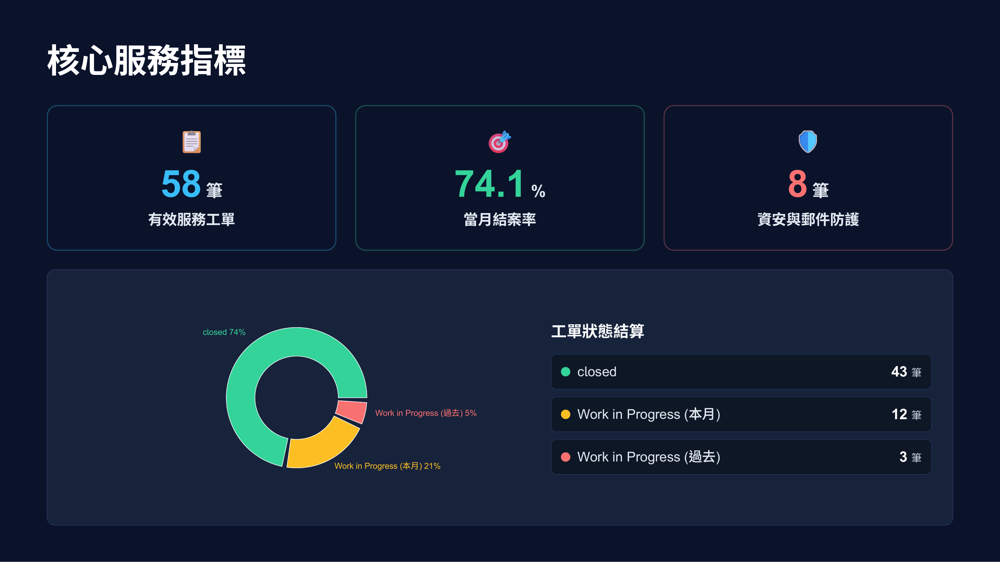
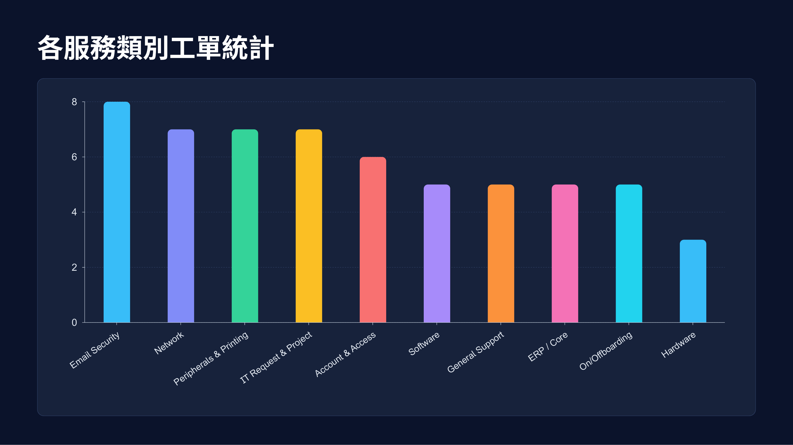
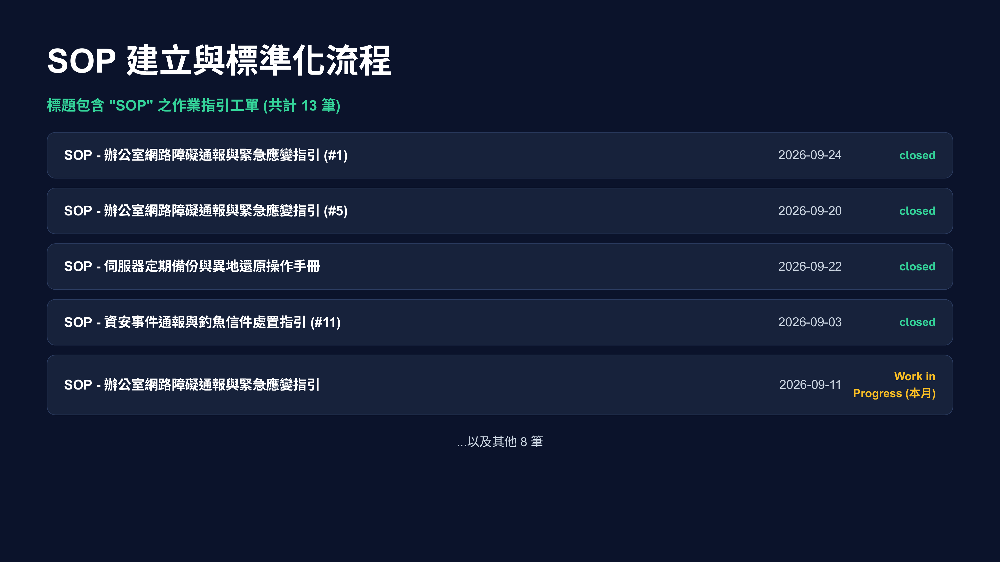

# 📊 Zammad Monthly Report & Slide Generator

<div align="center">

🌐 **[English](README.md)** | **[繁體中文 (Traditional Chinese)](README.zh-TW.md)**

<br />

[](https://python.org)
[](https://reactjs.org/)
[](https://open-slide.dev/)
[](https://github.com/Json105/Zammad-Monthly-Report/actions/workflows/ci.yml)
[](LICENSE)

**自動從 Zammad 工單系統依月度、15 日結算週期或自訂日期區間擷取數據，產出結構化分頁 Excel 稽核報表與白牌互動式簡報。**

<br />


<br />
<br />

[🎯 背景與效益](#-專案背景與效益) •
[📸 成果展示](#-成果展示-interactive-showcase) •
[✨ 快速體驗](#-1-分鐘快速體驗-mock-demo-模式) •
[🚀 正式安裝](#-正式使用-連線-zammad) •
[📖 參數指南](#-cli-指令與參數說明)

</div>

---

## 🎯 專案背景與效益

### 📌 痛點與開發背景
在企業 IT 運維與客服支援的日常工作中，每逢定期結算常面臨以下挑戰：
- **繁瑣耗時的人工作業**：每期需手動從 Zammad 匯出資料、清洗工單欄位、排除 `merged` 重複工單並在 Excel 中逐一分類整理，耗費數小時重複勞動。
- **簡報製作與核對成本高**：向主管或跨部門報告時，需重新手動繪製圖表並貼入 PPT，既耗時又常因口徑不一導致簡報數字與 Excel 總表對不起來。
- **工單分類與週期切分失真**：進線工單常堆積在 `Others`（未分類）群組，且跨月計費／SLA 結算週期（如每月 15 日至次月 15 日）難以用傳統整月報表精準統計。

### 🚀 導入效益與核心價值
- ⏱️ **省時 90% 以上**：將原本耗時數小時的資料整理、Excel 美化與 PPT 製作，縮短至 **一鍵 10 秒內** 自動產出結構化 Excel 與互動簡報。
- 📊 **100% 單一真相口徑對齊**：透過共用分類引擎（`zammad_utils/report_metrics.py`）自動排除 `merged` 重複單，確保 Excel 結構化表格（`ValidServiceTickets`、`AuditSummary`）與 React / Recharts 簡報指標數字完全一致，並內建簡報內即時明細檢視與一鍵下載 `.xlsx`。
- 📅 **彈性結算週期支援**：原生支援**每月 15 日為基準之服務週期**、任意 `--start` / `--end` 自訂起迄區間，以及 `--full-month` 完整自然月，精準區分「當期新進」、「跨期結案/異動」與「歷史在辦未結」。
- 🔒 **白牌隔離與零外洩架構**：公司名稱、聯絡資訊、總部支援標籤與自訂 SVG Logo 皆透過納入 `.gitignore` 的 `.env` 注入，程式碼本體保持通用專業且可直接作為公開作品集展示。
- 🛡️ **自動化驗收閉環與 CI**：內建 `./scripts/check-done.sh`（語法檢查、模組匯入、**84 項 `pytest` 單元測試**與可選前端建置驗證），結合 `.agents/hooks.json` 的 `Stop` hook 與 GitHub Actions CI 確保品質不退化。
- 🤖 **智慧工單重分類**：內建規則引擎與 Dry-Run 預覽，自動將 `Others` 工單精準歸類至所屬系統與部門。
- 🎲 **開箱即用與低門檻**：內建 `demo-report` 與 `--mock` 模擬模式，無需 Zammad Token 即可秒級體驗完整流程。

---

## 📸 成果展示 (Interactive Showcase)

本專案支援將工單數據自動轉化為高視覺水準之動態投影片（基於 React 18 + Open-Slide + Recharts）：

### 1. 核心營運指標與狀態結算 (Executive KPIs & Status Distribution)
一目了然掌握總工單量、當月結案率、資安事件總數，並透過互動式 Donut 環形圖即時檢視處理進度：
<div align="center">
  
</div>

<br />

### 2. 各服務領域工單統計 (Service Category Breakdown)
自動彙整軟硬體、資安防護、帳號權限與日常維運負載，以高對比色柱狀圖直觀揭示部門業務分佈：
<div align="center">
  
</div>

<br />

### 3. SOP 標準化流程與重點追蹤工單 (SOP & Workflow Tracking)
自動穿透檢索標註 `SOP` 與重點關注之工單，輔助技術知識庫沉澱與制度落實：
<div align="center">
  
</div>

---

## ✨ 核心特色

- 🔄 **自動化 Zammad 資料擷取**：透過 REST API 批次撈取工單、狀態、群組、處理人與標籤，自動過濾授權網域（`ALLOWED_DOMAINS`）並排除統計區間前已結案的陳舊工單。
- 📅 **多週期與自訂區間支援**：預設支援每月 15 日為基準之結算週期，亦可透過 `--start` / `--end` 指定任意起迄日期，或加上 `--full-month` 切回傳統自然月。
- 📑 **結構化 Excel 稽核表**：自動產出具備凍結窗格與 CJK 自動欄寬的 Excel Table（`ValidServiceTickets`、`AuditSummary`、`AllTickets` 及依狀態拆分之工作表），方便管理層即時核對。
- 🎞️ **白牌現代化互動簡報**：採用 [Open-Slide](https://open-slide.dev/) ([GitHub](https://github.com/1weiho/open-slide)) + Recharts 與等角企業設計系統，支援：
  - 🍩 工單狀態佔比環形圖與 IT 服務領域佔比分析
  - 📊 各服務類別柱狀圖與自動分頁之進行中積壓工單追蹤
  - 🏷️ 跨國協同與總部支援標籤追蹤（`VITE_HQ_EMAIL`）
  - 📝 SOP 標準化流程與知識庫工單追蹤
  - 📥 簡報內直接展開有效工單明細表與一鍵下載 `.xlsx` 附件
  - 🎯 動態下期關鍵里程碑與 `.env` 白牌品牌／SVG Logo 注入
- 🧪 **自動化驗收閉環**：提供 `./scripts/check-done.sh`、`.agents/hooks.json`（`Stop` hook）與 GitHub Actions CI，確保語法、模組匯入、84 項單元測試與前端建置持續通過。
- 🎲 **內建 Mock 模式**：沒有 Zammad API 帳號也能 1 秒產生模擬資料，快速體驗完整功能！

---

## ⚡ 1 分鐘快速體驗 (Mock Demo 模式)

想先看看產出的報表與簡報長什麼樣子？本專案**已內建一組完整的模擬示範簡報 (`demo-report`)**，免連線 Zammad 也無需先設定 Python 即可直接體驗：

```bash
# 1. 複製專案並進入簡報目錄
git clone https://github.com/Json105/Zammad-Monthly-Report.git
cd Zammad-Monthly-Report/zammad-report-slide

# 2. 安裝依賴並啟動簡報
npm install
npm run dev
```

瀏覽器打開 `http://localhost:5174/` 點選左側選單的 **`IT Service Monthly Report (Demo)`** 即可立即體驗！

👉 **若想自訂模擬筆數或同時產出 Excel 報表**：
```bash
# 返回專案根目錄
cd ..
python -m venv venv && source venv/bin/activate
pip install -r requirements.txt
python generate_report.py --mock --mock-count 80
```

---

## 🚀 正式使用 (連線 Zammad)

### 步驟 1：設定環境變數

複製環境變數範本並填入你的 Zammad 連線資訊：

```bash
cp .env.example .env
```

編輯 `.env`：

```env
ZAMMAD_URL=https://support.your-company.com
ZAMMAD_API_TOKEN=your_actual_zammad_api_token_here
ALLOWED_DOMAINS=@your-company.com
```

*(選填)* 若要在本機簡報套用客製化企業品牌、總部支援標籤或自訂 SVG Logo（不影響 Git 追蹤程式），可複製範本設定：

```bash
cp zammad-report-slide/.env.example zammad-report-slide/.env
```

> 💡 **Token 取得方式**：登入 Zammad ➜ 點選個人頭像 ➜ **Profile (個人資料)** ➜ **Token Access** ➜ 建立一個擁有 `ticket.agent` 或相關讀取權限的 Personal Access Token。

### 步驟 2：執行報表與簡報資料產生

```bash
# 預設以每月 15 日為基準抓取最新完整週期（例如前月 15 日至當月 15 日）
python generate_report.py

# 指定結束於特定月份 15 日的週期（如 --month 2026-11 代表 2026-10-15 ~ 2026-11-15）
python generate_report.py --month 2026-11

# 或改用完整自然月模式（1 號至月底）
python generate_report.py --month 2026-10 --full-month

# 或指定任意自訂起迄日期區間
python generate_report.py --start 2026-10-15 --end 2026-11-17
```

執行後會產出：
1. `Zammad_Report_<區間>.xlsx`：含 `有效服務工單`、`統計驗證摘要`、`全部工單` 與各狀態分頁之結構化 Excel 報表。
2. `zammad-report-slide/public/data/tickets_<區間>.json` 與 `tickets.json`：供簡報讀取的結構化 JSON。
3. `zammad-report-slide/slides/report-<區間>/index.tsx`：自動產生的 Open-Slide 簡報頁面（內建 Excel 附件下載）。

### 步驟 3：開啟互動式簡報

```bash
cd zammad-report-slide
npm run dev
```

---

## 📖 CLI 指令與參數說明

| 參數 | 說明 | 範例 |
| :--- | :--- | :--- |
| *(無參數)* | 預設以**每月 15 日為基準**抓取最新完整週期真實工單 | `python generate_report.py` |
| `--month YYYY-MM` | 指定結束月份（週期模式），或搭配 `--full-month` 指定自然月 | `python generate_report.py --month 2026-11` |
| `--cutoff-day N` | 自訂每月結算基準日（預設：`15`） | `python generate_report.py --cutoff-day 20` |
| `--full-month` | 改用完整自然月（每月 1 號至月底） | `python generate_report.py --month 2026-10 --full-month` |
| `--start` / `--end` | 自訂起迄日期區間（格式：`YYYY-MM-DD`） | `python generate_report.py --start 2026-10-15 --end 2026-11-17` |
| `--mock` | 使用模擬資料模式（免連線 Zammad） | `python generate_report.py --mock` |
| `--mock-count N` | 自訂模擬工單筆數（預設：`60`） | `python generate_report.py --mock --mock-count 100` |
| `-h`, `--help` | 查看說明訊息 | `python generate_report.py -h` |

---

## 🛠️ 其他輔助工具

- **查詢 Zammad 系統狀態列表**：
  ```bash
  python get_states.py
  ```
- **擷取目前 Zammad 系統全部使用者、群組與狀態對照表**：
  ```bash
  python export_zammad_data.py
  ```
- **「Others」未分類工單智慧重分類**：
  ```bash
  # 預覽上個月的建議重分類結果 (不實際寫入)
  python reclassify_others.py --dry-run

  # 套用特定月份的重分類
  python reclassify_others.py --month 2026-07
  ```

---

## 🧪 執行單元測試與自動化驗收

執行專案整合驗收腳本（涵蓋 Python `py_compile` 語法檢查、核心模組匯入檢查與 **84 項** `pytest` 單元測試）：

```bash
./scripts/check-done.sh
```

若要同時驗證 Open-Slide 前端正式建置（`npm run build`）：

```bash
./scripts/check-done.sh --with-frontend
```

亦可單獨執行 `pytest`：

```bash
pytest
# 或是
python -m pytest tests/ -v
```

> 🤖 **自動化品質把關**：本專案透過 `.agents/hooks.json` 設定 `Stop` hook，在程式碼有變更時自動執行 `../scripts/check-done.sh --hook`，並搭配 `.agents/goal-template.md` 與 `AGENTS.md` 規範任務執行與測試完整性。

---

## 📁 專案目錄結構

```text
zammad-monthly-report/
├── .env.example            # 後端環境變數設定範本 (請複製為 .env)
├── .gitignore              # 隔離機敏設定、真實工單匯出與生成簡報
├── AGENTS.md               # Workspace 工程與測試完整性規範
├── pyproject.toml          # Python 專案描述與工具設定
├── requirements.txt        # Python 依賴套件清單
├── README.md               # 英文專案說明文件
├── README.zh-TW.md         # 繁體中文專案說明文件
├── generate_report.py      # 🌟 主程式：產出結構化 Excel 稽核報表與簡報資料
├── reclassify_others.py    # 輔助：工單智慧重分類工具
├── export_zammad_data.py   # 輔助：匯出對照字典
├── get_states.py           # 輔助：查詢工單狀態代碼
├── scripts/
│   └── check-done.sh       # 🛡️ 整合驗收腳本（支援 CLI 與 Stop hook 模式）
├── .agents/
│   ├── hooks.json          # Stop hook 設定（自動執行 check-done.sh --hook）
│   └── goal-template.md    # 符合本專案技術棧的 /goal 任務提示詞模板
├── zammad_utils/           # 📦 共用 Python 模組
│   ├── config.py           #    統一環境設定載入、網域過濾與 HTTPS 檢查
│   ├── api.py              #    共用 Zammad API 呼叫
│   ├── date_utils.py       #    自然月、15 日結算週期與自訂區間計算
│   └── report_metrics.py   #    單一真相口徑分類器與 Excel Table 格式化
├── tests/                  # 🧪 單元測試 (84 項 pytest)
│   ├── test_api.py
│   ├── test_config.py
│   ├── test_date_utils.py
│   ├── test_reclassify.py
│   ├── test_report_filter.py
│   └── test_slide_metrics.py
└── zammad-report-slide/    # 🌟 Open-Slide 簡報專案
    ├── .env.example        # 簡報白牌品牌、HQ 標記與自訂 SVG Logo 範本
    ├── env.d.ts            # Vite 靜態資源與 .xlsx?url 型別宣告
    ├── package.json
    ├── tsconfig.json
    ├── open-slide.config.ts
    ├── assets/isometric/   # 通用 3D 等角封面與結尾插圖
    ├── public/data/
    │   └── tickets.json    # 報表程式產出的工單資料來源 (不納入 Git)
    ├── themes/
    │   └── monthlyReportTemplate.tsx # 白牌等角投影片設計與 Recharts 圖表
    └── slides/
        ├── demo-report/    # 🌟 內建 Demo 模擬簡報 (開箱即看)
        └── report-<區間>/  # 各週期自動產出的簡報 (不納入 Git)
```

---

## 📄 授權條款 (License)

MIT © [Jason Liao](https://github.com/Json105)
